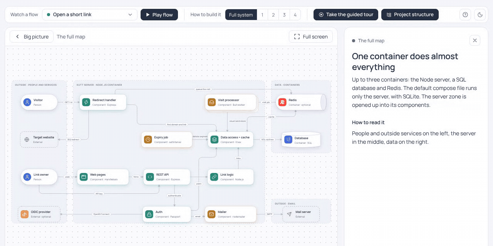
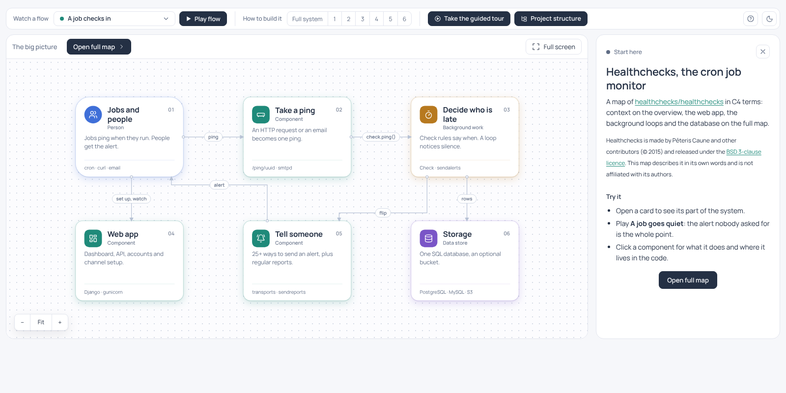
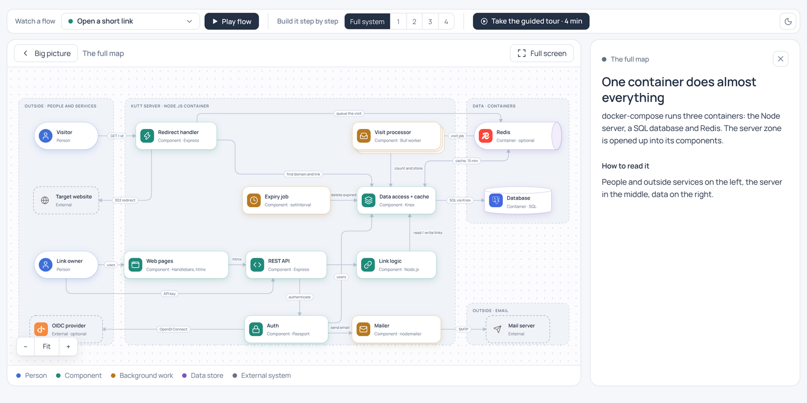
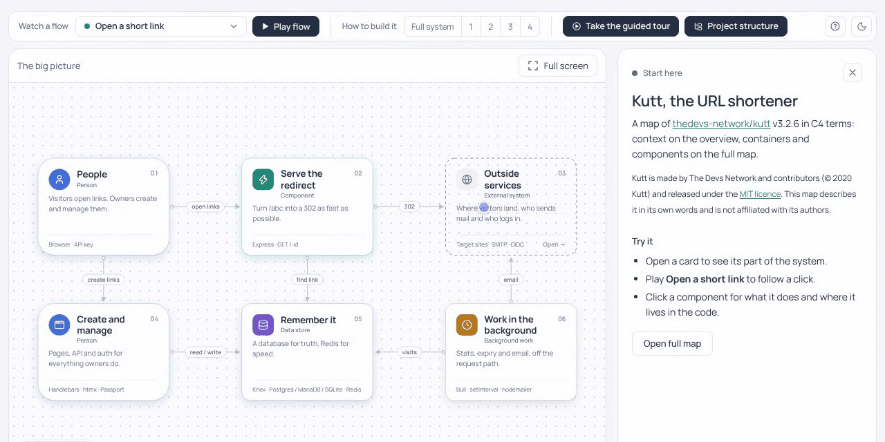
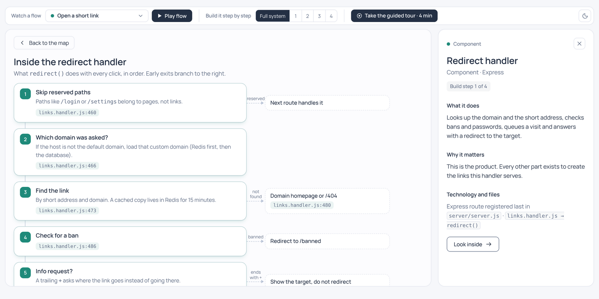
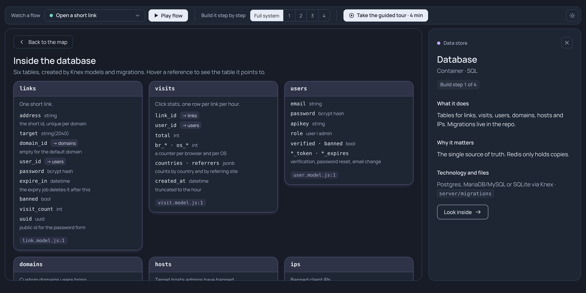
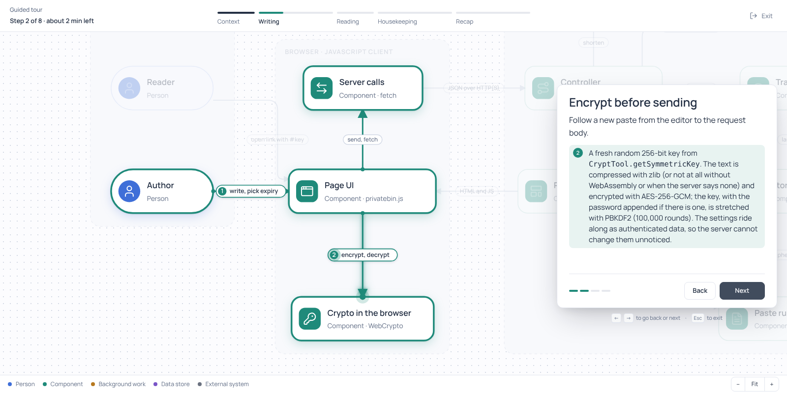
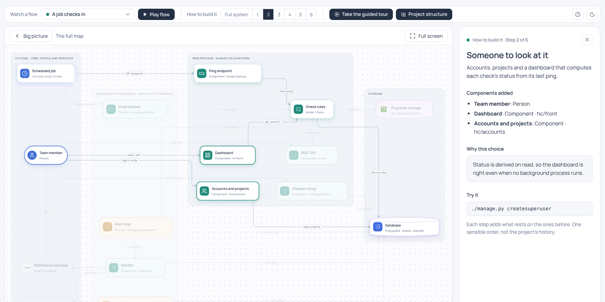
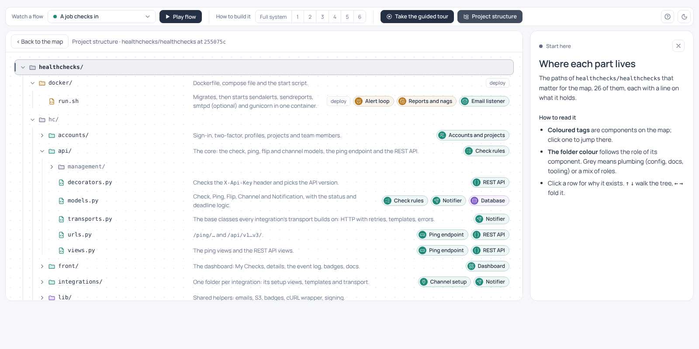

<div align="center">

# Interactive Map Builder

[](#install)
[](plugins/interactive-map/.claude-plugin/plugin.json)
[](#install)

[](#how-it-works)
[](LICENSE)
[](https://github.com/chekrizh/Interactive-Map-Builder/stargazers)

**Deep dives into how a system works: from the big picture down to a line of code, as one interactive map.**

This skill is for understanding: it gives the agent a method for studying a repository or a topic and a ready-made viewer built for going deep.<br>
Levels you drill into, animated flows, step-by-step code walkthroughs, a guided tour, and every claim linked to its source. The agent spends its effort on the explanation instead of building the page.

[Features](#features) · [Modes](#three-modes) · [Install](#install) · [How it works](#how-it-works)

<br>



<sub>One of the flows on a map of the <a href="https://github.com/thedevs-network/kutt">Kutt</a> URL shortener, made by the skill.</sub>

</div>

---

## Features

- [**Overview**](#overview): the whole system in a few cards.
- [**Full map**](#full-map): every part and how they connect.
- [**Flows**](#flows): watch a request or a process move through the system.
- [**Look inside**](#look-inside): open one component and see how it works step by step.
- [**Guided tour**](#guided-tour): a short walk through the map, good for a first visit.
- [**How to build it**](#how-to-build-it): the system assembled from scratch, piece by piece.
- [**Project structure**](#project-structure): the repository's folders and files, each tied to its part of the map.

Every map is one HTML file. It opens offline, in light or dark, and every claim points to its source. A **?** button beside the theme switch says which view answers which question.

### Overview

The first screen. Who uses the system, what it is made of and what it depends on, in a handful of cards. It is the picture you would draw on a whiteboard before going into details. Click a card to open that part.

<picture>
  <source media="(prefers-color-scheme: dark)" srcset="docs/readme/overview-dark.png">
  
</picture>

### Full map

All the parts of the system and the connections between them, grouped into zones. Click any of them to see what it does, why it matters and which files it lives in.

For a repository the map follows the [C4 model](https://c4model.com): *containers* are the pieces that run separately (a server, a database, a queue), *components* are the main parts inside them. You do not need to know C4 to read the map.



### Flows

A diagram shows what is connected; a flow shows what actually happens. Pick a scenario, such as "a visitor opens a link", and press *Play flow*: the path lights up hop by hop while the panel explains each step. The GIF at the top is one of them.

### Look inside

Some components deserve a closer look. *Look inside* opens a close-up: a code walkthrough in the order the code runs, with the early exits and links to exact lines, or the tables of a database and how they relate.



<table>
  <tr>
    <td width="50%"></td>
    <td width="50%"></td>
  </tr>
</table>

### Guided tour

For someone who opens the map for the first time and does not know where to start. A few minutes in short chapters: the context, a click, a new link, the background work, a recap. *Next* moves the map and explains what you are looking at.



### How to build it

How you would build the system from scratch. Switch from *Full system* to step 1, 2, 3: each step adds a few components and says why they come now. Good for seeing what is the core and what was added on top. It is one sensible order for understanding the system, not a history of the project.



### Project structure

What the repository is made of. The folders and files that matter, each with a line on what lives there and why it exists, coloured by the part of the map it belongs to. Tags on a row jump to the component on the map, and a component's panel leads back to its folders.




## Install

**Claude Code, through the marketplace (receives updates):**

```
/plugin marketplace add chekrizh/Interactive-Map-Builder
/plugin install interactive-map@interactive-map-builder
```

Then just ask, for example:

> Draw an interactive map of how this repository works.

The skill triggers on its own. It is also available as `/interactive-map:interactive-map`, and the repository method as `/interactive-map:interactive-map-repo`.

- Update on request: `/plugin marketplace update interactive-map-builder`, or `claude plugin update interactive-map@interactive-map-builder` in a shell.
- Update automatically: `/plugin` → Marketplaces → interactive-map-builder → Enable auto-update. It is off by default for marketplaces like this one.

<details>
<summary><b>Other clients</b> (no automatic updates; install the new copy again)</summary>

<br>

The skills are the folders in `plugins/interactive-map/skills/`.

- **Claude Code without the marketplace:** `cp -R plugins/interactive-map/skills/* ~/.claude/skills/`, then start a new session.
- **Claude apps (desktop, web):** `cd plugins/interactive-map/skills && zip -r interactive-map.zip interactive-map` (and the same for `interactive-map-repo`), then upload each zip under Settings → Capabilities → Skills. Code execution must be on.
- **Codex:** copy the skill folders into the skills folder Codex reads (`~/.codex/skills/` at the time of writing).
- **ChatGPT:** upload the same zips where your workspace allows custom skills. This path has not been checked here.

</details>

## How it works

```
 subject ──► agent designs the map ──► map.json ──► render.py ──► map.html
 (repo, topic)   (skills decide what      (nodes, flows,   (checks it, fills    (viewer + map,
                  goes on the map)         tour, layout)    icons and logos)     works offline)
```

- **Two skills.** `interactive-map-repo` is the method for repositories: find the evidence (deployment files, entry points, contracts), model it in [C4](https://c4model.com) terms (context on the overview, containers and components on the full map) and pick the flows worth animating. `interactive-map` is the format: how to write the map JSON and render it.
- **The agent never writes HTML.** It writes one JSON definition. `render.py` (Python 3, standard library only) validates it with the same checks the page runs, lists every problem at once, sanitises its text, and puts it into the prebuilt viewer.
- **An asset library is built in.** About 2,300 [Lucide](https://lucide.dev) icons, about 3,500 brand logos from [Simple Icons](https://simpleicons.org) and [gilbarbara/logos](https://github.com/gilbarbara/logos), and role presets with tested light and dark colours. A map only names them.
- **The output is self-contained.** Each HTML file carries its own copy of the viewer, the map and the font, so it keeps working when the skill changes.

Render the bundled example yourself:

```bash
python3 plugins/interactive-map/skills/interactive-map/scripts/render.py \
  plugins/interactive-map/skills/interactive-map/examples/kutt-url-shortener.json /tmp/map.html
open /tmp/map.html
```

## What the plugin does on your machine

- **Only instructions and two scripts.** The plugin adds two skills. It has no hooks, no MCP servers and no settings changes.
- **Python scripts, standard library only.** `render.py` reads the map JSON, the viewer in `assets/viewer/` and the asset library, strips any HTML outside a small allowlist from the map's text (`contract.py`), and writes one HTML file to the path you give it. With `--repo-dir` it also reads the repository checkout you name, to check that code references and paths exist. `find_asset.py` searches the asset library and prints names. None of them makes network requests, runs other programs or reads anything outside the skill folder, the map and the checkout you pass.
- **The generated page works offline.** Its script, styles, font, icons and logos are inlined; it makes no network requests and sends nothing anywhere.
- **Everything shipped is readable.** The viewer is committed unminified (built from `app/`), and the icon and logo library is split into JSON files with one item per line (built by `tools/build_library.py`), so every file stays under 256 KB and can be reviewed.

## License

[MIT](LICENSE). Bundled assets keep their own licenses: [Lucide](https://lucide.dev) icons (ISC), [Simple Icons](https://simpleicons.org) and [gilbarbara/logos](https://github.com/gilbarbara/logos) (CC0; brand marks remain trademarks of their owners), the Manrope font (SIL Open Font License). The example maps describe [Kutt](https://github.com/thedevs-network/kutt) (The Devs Network and contributors, MIT), [PrivateBin](https://github.com/PrivateBin/PrivateBin) (Sébastien Sauvage and the PrivateBin contributors, zlib/libpng) and [Healthchecks](https://github.com/healthchecks/healthchecks) (Pēteris Caune and other contributors, BSD 3-clause); they copy none of their code, and the [examples README](plugins/interactive-map/skills/interactive-map/examples/README.md) links each licence and mapped commit.
